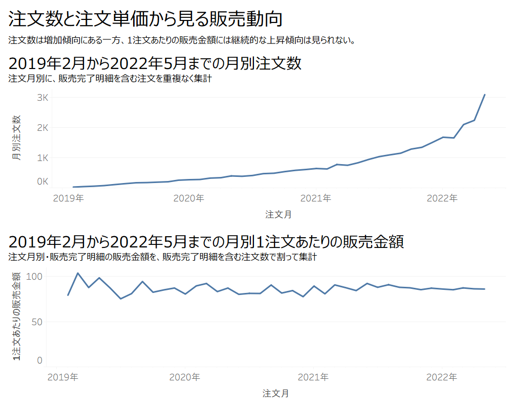
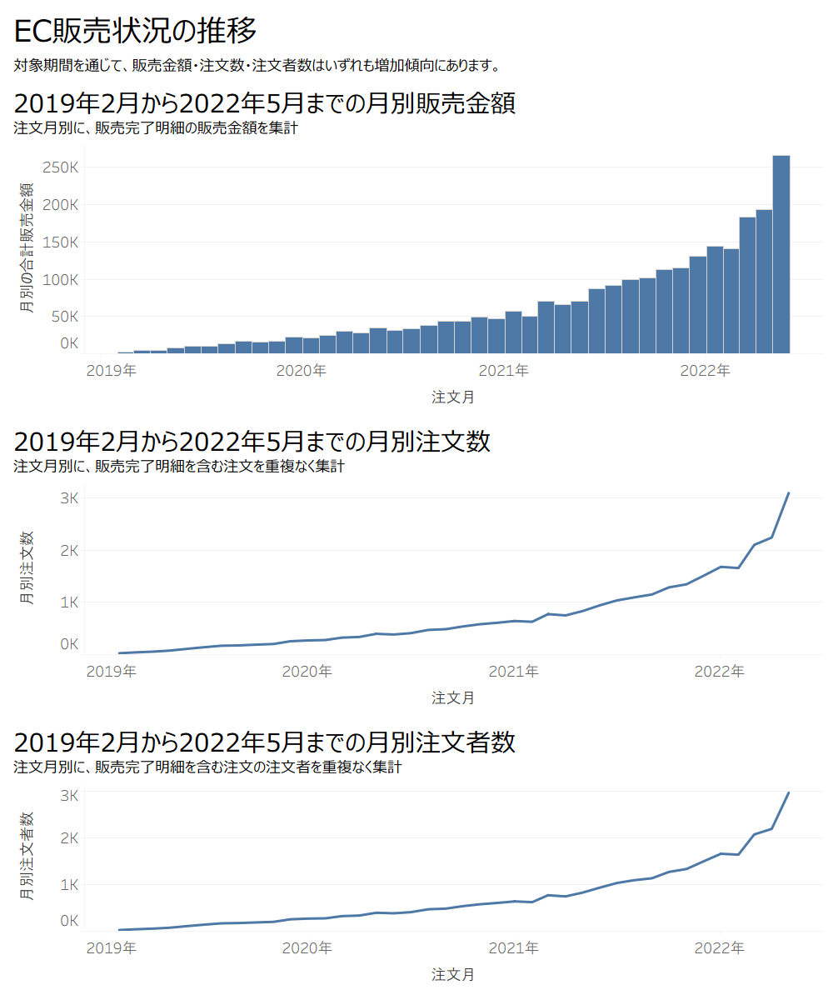
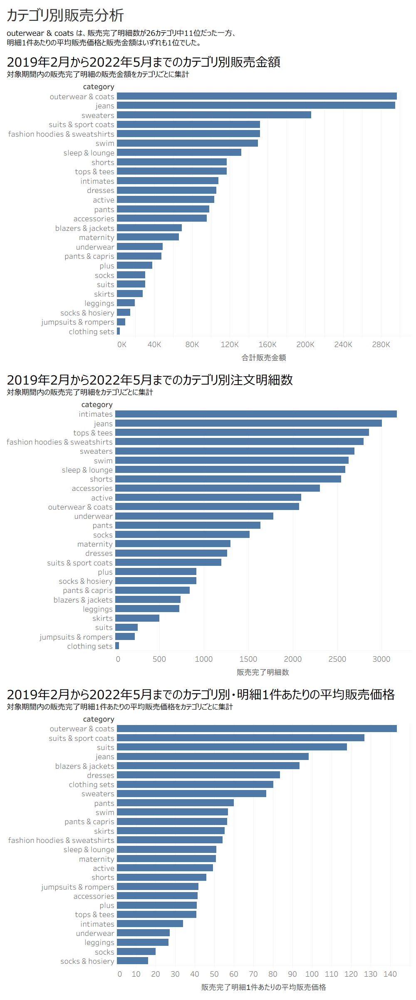

# TheLook EC 販売分析｜Amazon Athena × Tableau

架空のECデータを用い、販売金額の推移と商品カテゴリの特徴を分析したポートフォリオです。処理・検証済みのParquetデータをAmazon S3に保管し、Amazon Athenaで結合・加工したデータをTableauに直接接続して可視化しました。

## 分析結果

- **販売金額の推移**：2019年2月〜2022年5月の販売金額と注文数は増加傾向にある一方、1注文あたりの販売金額には継続的な上昇傾向が見られませんでした。販売金額の増加には、注文数の増加が関係していると考えられます。
- **カテゴリ別の特徴**：`outerwear & coats` は、販売完了明細数が26カテゴリ中11位の2,070件だった一方、明細1件あたりの平均販売価格と販売金額はいずれも1位でした。平均価格の高さが販売金額に関係していると考えられます。



## ダッシュボード

### EC販売状況の推移

月別の販売金額・注文数・注文者数を比較します。3つの指標はいずれも対象期間を通じて増加傾向にありました。



### カテゴリ別販売分析

カテゴリ別の販売金額、販売完了明細数、明細1件あたりの平均販売価格を比較します。



## データの流れと使用技術

```text
Amazon S3（処理・検証済みParquet）
    ↓
Amazon Athena（SQLによる結合・絞り込み・欠損値の補完）
    ↓  Tableauから直接接続
Tableau Desktop（抽出データの作成・集計・可視化）
```

- **Amazon S3**：前工程で処理・検証したParquetファイルを保管。
- **Amazon Athena**：`order_items`・`orders`・`products` を結合し、販売完了明細を抽出。ブランドの欠損値は「不明」として扱いました。
- **Tableau Desktop**：AthenaのカスタムSQLに直接接続し、抽出データを用いて分析・ダッシュボードを作成。

Tableau用データソースSQLを整理したものは、[tableau_data_source.sql](sql/tableau_data_source.sql) で確認できます。

Athenaのテーブル作成は、[create_athena_tables.sql](sql/create_athena_tables.sql) を参考にできます。実行前に `<YOUR_BUCKET>` を自分のS3バケット名に置き換え、各 `LOCATION` をParquetファイルがある場所に合わせてください。以下は再現用に整理した配置例です。

```text
s3://<YOUR_BUCKET>/processed/athena_source/
├── orders/       ordersのParquetファイル
├── order_items/  order_itemsのParquetファイル
└── products/     productsのParquetファイル
```

この配置は例であり、元のクエリ履歴ではテーブルごとのパス表記が異なります。再現用SQLのAthenaでの実行は未確認です。
Athenaのクエリ履歴は、[athena_query_history.sql](sql/athena_query_history.sql) にまとめています。テーブル作成、品質確認、分析用データの準備、Tableauとの集計値の照合を含みます。公開用にS3バケット名を置き換え、読みやすさのために整形しています。一括実行用のスクリプトではありません。

## フォルダー構成

```text
├── README.md
├── images/                       ダッシュボード画像
│   ├── 注文数と注文単価から見る販売動向.png
│   ├── EC販売状況の推移.png
│   └── カテゴリ別販売分析.png
└── sql/
    ├── create_athena_tables.sql  Athenaテーブル作成例
    ├── tableau_data_source.sql   Tableauのデータソースに使用したSQL
    └── athena_query_history.sql   Athenaのクエリ履歴（公開用）
```

## 指標と分析条件

- 対象期間：**2019年2月〜2022年5月**。抽出データの最初と最後にあたる2019年1月・2022年6月は、月単位の比較から除外しました。
- 対象明細：`order_items.status = 'complete'` の販売完了明細。月別の期間は注文日時を基準としています。
- 注文数：販売完了明細を含む注文の `order_id` を重複なくカウント。
- 注文者数：販売完了明細を含む注文の `user_id` を、月ごとに重複なくカウント。
- 1注文あたりの販売金額：販売完了明細の販売金額の合計 ÷ 販売完了明細を含む注文数。その他のステータスの明細金額は含みません。
- カテゴリ別の平均販売価格：販売完了明細1件あたりの `sale_price` の平均。
- 通貨単位：出典から確認できていません。

## データ検証と工夫

- 3テーブルの結合前に、結合先のIDの重複・NULLと結合できない明細を確認。結合前後で注文明細数が **180,952行**であることを確認しました。
- 販売完了明細 **45,010行**のうち、ブランドがNULLの39行を除外せず「不明」として扱いました。
- Tableauの集計値をAthenaのSQL結果と照合しました。2022年5月の注文者数が一致しなかった際には、Tableauの日時フィルターの終了時刻を修正し、両者が **2,969人**で一致することを確認しました。同月の注文数 **3,098件**、販売金額 **266,289.87**（小数第2位まで）も照合しました。
- データの最初と最後の注文日時を確認し、途中月を月別比較から除外しました。

## 制約と今後の分析

- 分析対象は販売完了明細のみであり、注文全体のすべての明細や、サイト訪問者全体を表すものではありません。
- 指標の同時増加だけでは、知名度の上昇などの原因や因果関係は判断できません。
- 今後、必要なデータを取得できれば、`outerwear & coats` の原価を踏まえた利益率や在庫回転率を算出し、収益性と在庫効率の両面から評価することが考えられます。

## データについて

TheLook eCommerceの架空データを使用しました。

- 入手元：[Kaggle TheLook eCommerce](https://www.kaggle.com/datasets/daichiuchigashima/thelook-ecommerce)
- 利用条件：Kaggleページのライセンス表示は `Unknown` です。データや分析画像の公開・再配布に関する条件は未確認です。
